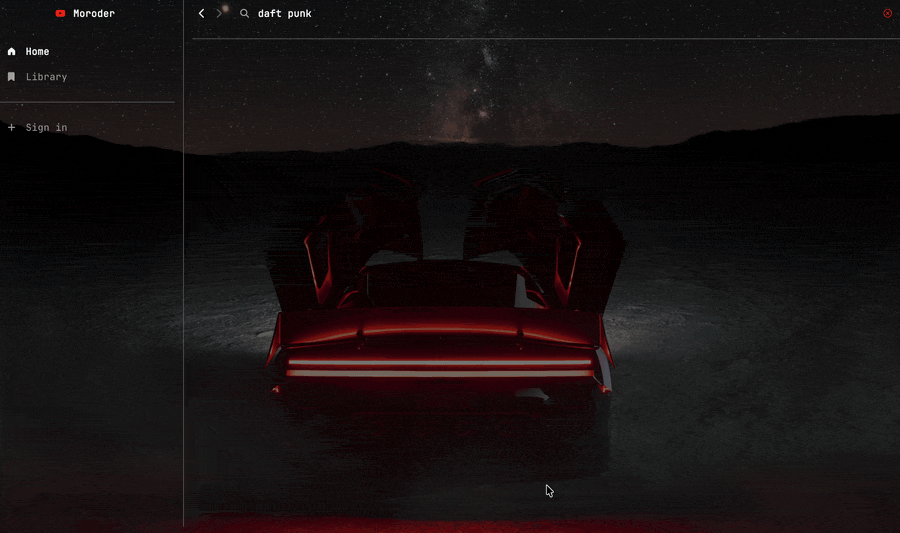

<div align="center">

# Moroder

**YouTube Music in your terminal.**<br>
Keyboard, mouse or trackpad. macOS and Linux.

<a href="https://github.com/wolf75222/moroder/releases/latest"></a>




| 🎧 Playback | 🎤 Lyrics | 🖱️ Controls |
|:--|:--|:--|
| Gapless, starts fast | Synced, sung along | Click, swipe, scroll |
| Queue, radio, shuffle | Album art in color | Right-click menus |
| Your library and playlists | Full-screen view | Media keys, Now Playing |

</div>

## Install

**1.** Install (macOS or Linux):

```bash
curl -fsSL https://raw.githubusercontent.com/wolf75222/moroder/main/install.sh | sh
```

**2.** Sign in, once (uses your browser's YouTube Music session):

```bash
moroder setup
```

**3.** Play:

```bash
moroder
```

No account? `moroder -a` plays without one. New releases are offered at launch.

## Commands

| Command | Does |
|:--|:--|
| `moroder search daft punk` | open on search results |
| `moroder update` | install the latest release |
| `moroder doctor` | check yt-dlp, mpv, sign-in, terminal |
| `moroder uninstall` | remove it (asks before deleting settings) |

## Keys

| Key | Does |
|:--|:--|
| <kbd>Enter</kbd> · double-click | play |
| <kbd>Space</kbd> | play / pause |
| <kbd>&lt;</kbd> <kbd>&gt;</kbd> · <kbd>⇧</kbd> + <kbd>←</kbd> <kbd>→</kbd> | previous / next |
| <kbd>/</kbd> | search |
| <kbd>v</kbd> | lyrics |
| <kbd>Esc</kbd> · <kbd>]</kbd> | back · forward |
| right-click | everything else |
| hold <kbd>h</kbd> | all the keys |

<div align="center">

<br>

[Install](docs/install.md) · [Usage](docs/usage.md) · [Configuration](docs/configuration.md) · [Integrations](docs/integrations.md) · [Internals](docs/internals.md) · [Troubleshooting](docs/troubleshooting.md)

<br>

<sub>Fork of <a href="https://github.com/orrnithogalum/moroder">orrnithogalum/moroder</a>, ported to macOS and enhanced</sub>

</div>
