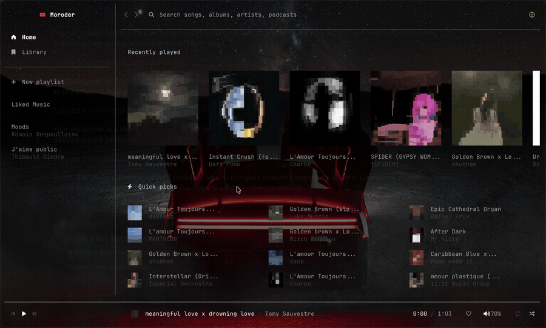

# Moroder

<p align="center">
  
</p>

A YouTube Music player for the terminal, in C++, that you drive with the
keyboard, the mouse or the trackpad. Runs on macOS and Linux.

- **Fast:** starts in a few seconds cold, at once for a song you have just
  selected; no gaps between tracks; every track plays at the same loudness
- **Your music:** home, library, search with suggestions, artists, albums,
  playlists (create, rename, edit), radio, queue with drag and drop
- **On screen:** album covers in the terminal, and a Now Playing view whose
  lyrics fill in word by word as they are sung
- **Natural to use:** click, right-click, scroll, swipe, back / forward, a
  volume slider, a sleep timer, Last.fm, and media keys / Control Center on macOS

## Install (macOS)

```bash
brew install cmake pkg-config mpv yt-dlp
git clone https://github.com/wolf75222/moroder.git && cd moroder
cmake -S . -B build -DCMAKE_BUILD_TYPE=Release && cmake --build build -j
cmake --install build --prefix /opt/homebrew
```

Linux and other options: [Install](docs/install.md).

## Start

```bash
moroder setup    # sign in once, with your browser's YouTube Music session
moroder
```

| | |
|---|---|
| <kbd>Enter</kbd> / double-click | play |
| <kbd>Space</kbd> | play / pause |
| <kbd>⇧</kbd>/<kbd>⌥</kbd> + <kbd>←</kbd> <kbd>→</kbd>, <kbd>&lt;</kbd> <kbd>&gt;</kbd> | previous / next track |
| <kbd>/</kbd> | search |
| <kbd>v</kbd> | Now Playing and lyrics |
| <kbd>Esc</kbd> / <kbd>]</kbd> | back / forward |
| right-click | everything else |
| hold <kbd>h</kbd> or <kbd>?</kbd> | all the keys |

## Docs

[Install](docs/install.md) · [Usage](docs/usage.md) ·
[Configuration](docs/configuration.md) · [Integrations](docs/integrations.md) ·
[Internals](docs/internals.md) · [Troubleshooting](docs/troubleshooting.md)

The YouTube Music client is a C++ reimplementation of
[ytmusicapi](https://github.com/sigma67/ytmusicapi); MPRIS is adapted from
[mpris-server](https://github.com/chrg127/mpris-server).
